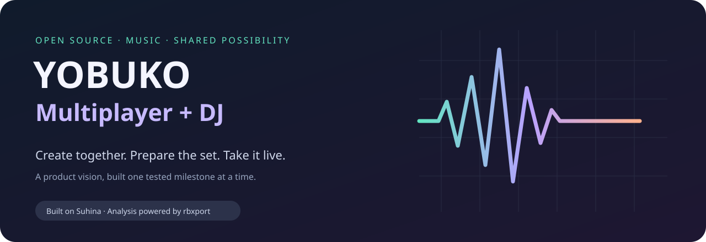

<p align="center">
  
</p>

<p align="center">
  <a href="https://github.com/Nozomagarion/suhina-daw/tree/feature/multiplayer"></a>
  <a href="LICENSE"></a>
  <a href="https://github.com/Nozomagarion/suhina-daw/actions/workflows/multiplayer-ci.yml?query=branch%3Afeature%2Fmultiplayer"></a>
</p>

<p align="center"><a href="README.md">Français / product vision</a> · <a href="#what-you-can-try">Try the prototype</a> · <a href="#progress-you-can-audit">Progress</a> · <a href="#standing-on-the-work-of-others">Credits</a> · <a href="docs/fork-distribution.md">Updates</a></p>

**One place to make music together, prepare a set and perform it.** That is the ambition of
this independent fork. It combines Suhina's native music production foundation with a custom
collaboration layer and DJ preparation using selected rbxport code.

The destination is a complete production-to-live workflow. The current build is an experimental
prototype: LAN sessions share a bounded copy of an open MIDI project or a four-track starter, and the DJ workspace provides a
local audio catalog and analysis. Full project coediting, shared recordings, performance decks
and USB export are future work. There is no common public release channel yet.

## The workflow we are building

| Create | Prepare | Perform |
|---|---|---|
| Produce with Suhina's engine, instruments and clip workflow. | Render a project into the DJ library; analyse tempo and key with rbxport code. | Build toward set preparation and live performance in the same app. |
| Collaborate on a common project while listening independently. | Keep the connection between your production and its rendered audio. | Keep everyone on the same tested combined version. |
| **Today:** restricted LAN MIDI note editing and mixer controls. | **Today:** native catalog, import, analysis and render bridge. | **Today:** product direction; decks and hardware export remain planned. |

## What you can try

- **Studio / Multiplayer / DJ** entry points in the native app.
- **Create LAN session / Join LAN session:** a private invitation connects one host and one guest.
  Share the current MIDI project (up to 64 tracks, FM Synth/Utility parameters only) or use the
  generated starter. Clips arrive in the verified initial copy; single-note add/update/delete, track names, volume
  and pan are live shared edits. The **MIDI notes** editor rejects stale drafts before indices shift. Play, stop and listening position stay local to each computer.
- **DJ library:** import audio, keep a persistent local catalog, analyse tempo/key and render a
  Studio project into the library.
- **Settings → General → GitHub updates…:** inspect the three GitHub source identities and check
  availability of a combined app update. An official standalone binary cannot overwrite the fork.

The network exchange is tested with real TLS loopback connections and two desktop project
instances. **A physical two-computer session has not yet been verified.** Audio files, your
audio assets, plugins and microphone recordings are not shared by this slice. MIDI notes can be edited while connected; clip placement remains fixed. Both apps need protocol 3.
[LAN contract and limits](docs/spec/lan-starter-session.md) · [Validation steps](docs/multiplayer-fork.md#try-the-desktop-lan-prototype)

## Progress you can audit

See the current [milestone table in the main overview](README.md#où-en-est-le-projet).

These bars count the explicitly listed criteria in [fork-progress.json](fork-progress.json).
They are **not percentages of engineering effort, stability or completion of the ultimate app**.
Implemented items link to code or validation evidence; pending items stay pending until their
acceptance gate is met. Rebuild the graphic with `python3 scripts/fork_readme.py`.

The next practical gate is running the same packaged build on two physical computers, followed
by portable project/media exchange. This distinction matters: sharing three track controls is
one foundation for collaborative production, not the finished experience.

## One app, one update path

```text
Suhina upstream ─┐
                ├─ isolated source integration ─ checks ─ combined build ─ in-app update
rbxport upstream┘               ↑
                      custom multiplayer + DJ modules
```

Friends should install the same combined distribution. Source updates are integrated and tested
with the custom modules before publication. Installed apps download that tested package; they
do not compile random upstream changes or replace themselves with an official standalone app.

Already implemented: source pins, an isolated integration candidate tool, component checks in
Settings, package source identity and a guard before replacement. Still pending: publishing and
validating the common update channel, and activating scheduled integration. A GitHub source
change is information; it does not mean a compatible combined update has been released.
[Distribution and maintenance design](docs/fork-distribution.md)

## Standing on the work of others

This project exists because of substantial work by other open-source authors.

| Project | What comes from it | What this fork adds |
|---|---|---|
| **[Suhina](https://github.com/suhina-daw/suhina-daw)** | The DAW foundation: native interface, audio engine, project model, session commands, instruments, effects, plugin hosting, CLI and automation. | Restricted collaboration, the DJ workspace/bridge and combined distribution controls. |
| **[rbxport](https://github.com/chrisle/rbxport)** by **chrisle and contributors** | The pinned `rbl-analysis` sources used for offline tempo/key analysis. The vendored subset is recorded with its license and source hashes. | Integration into the local DJ catalog. The rest of rbxport is not yet integrated; this fork does not claim its full feature set. |

Read [Suhina's original README](UPSTREAM_README.md), [ATTRIBUTION.md](ATTRIBUTION.md),
[NOTICE](NOTICE), [rbxport provenance](third_party/rbxport-analysis/VENDORED.md) and the exact
[source pins](fork-sources.json). Original authors retain their copyright. This is an independent
experimental fork, not an official release or endorsement from either upstream project.
It contains no proprietary music-software code or content.

## Build and inspect

Use **`feature/multiplayer`** for the combined app. `main` deliberately stays an exact upstream
mirror, so the custom modules and this presentation live on the feature branch.

```sh
git clone --branch feature/multiplayer https://github.com/Nozomagarion/suhina-daw.git
cd suhina-daw
cargo test --locked -p suhina-collaboration -p suhina-multiplayer -p suhina-dj -p suhina-update
cargo build --locked -p suhina -p suhina-cli -p suhina-plugin-host
```

Follow [build instructions](UPSTREAM_README.md#building) for platform prerequisites. Development artifacts are available
from successful [fork workflow runs](https://github.com/Nozomagarion/suhina-daw/actions/workflows/multiplayer-ci.yml?query=branch%3Afeature%2Fmultiplayer).
Check the run's commit and platform results; a compiled app alone does not establish that every
validation passed. A stable installer, production support and signed/notarized distribution are
not yet offered by this fork.

## Help shape it

Useful next contributions are reproducible two-computer results, portable project/media design,
shared note/clip editing and DJ preparation workflows. Include OS, build commit, precise steps
and expected/observed behavior in reports. Keep invitations private; they grant access to the
session for their short lifetime.

Follow [CONTRIBUTING.md](CONTRIBUTING.md), the [fork guide](docs/multiplayer-fork.md) and
[security boundary](docs/security/session-sharing.md). Discuss fork work on this fork; the
upstream projects have their own direction and contribution rules.

**GPL-3.0-or-later.** Packages must include required notices and corresponding source. See
[LICENSE](LICENSE) and the [distribution contract](docs/fork-distribution.md).
