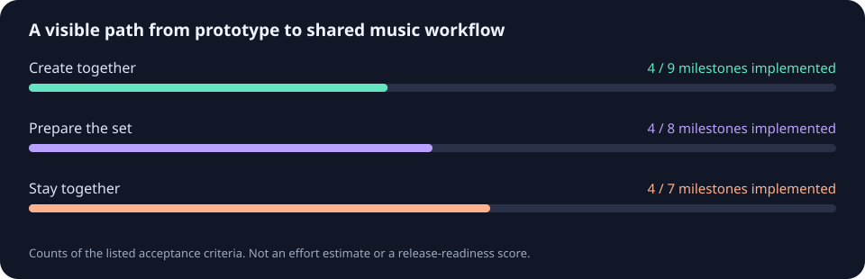

# Suhina Multiplayer + DJ

**L'ambition : réunir la production musicale à plusieurs, la préparation DJ et le live dans
une même application libre.** Ce fork indépendant s'appuie sur le travail de
[Suhina](https://github.com/suhina-daw/suhina-daw) et sur une partie de
[rbxport](https://github.com/chrisle/rbxport), créé par chrisle et ses contributeurs.

Suhina fournit le logiciel de production : interface, moteur audio, projets, instruments,
effets et hébergement des plugins. rbxport fournit ici son module d'analyse du tempo et de
la tonalité. Les ajouts de ce fork concernent le multijoueur, l'espace DJ et leur distribution
commune. Les autres fonctionnalités de rbxport restent à intégrer.

## Ce qui existe

- Un accès **Studio / Multiplayer / DJ** dans l'application.
- Une session locale **hôte + invité**, avec invitation privée et connexion chiffrée : quatre
  pistes MIDI générées sur chaque ordinateur, noms, volumes et panoramiques partagés. Chacun
  conserve sa lecture et sa position d'écoute.
- Une bibliothèque DJ persistante, l'import audio, l'analyse tempo/tonalité et l'envoi d'un
  rendu du projet vers cette bibliothèque.
- Le bouton **Settings → General → GitHub updates…**, qui compare les sources GitHub et
  cherche une version combinée compatible. Les modules personnalisés restent dans cette version.

Les échanges réseau sont testés entre deux instances sur le même ordinateur. **Le test sur deux
ordinateurs physiques reste à faire.** Les projets personnels, les fichiers audio, l'édition des
notes/clips et les enregistrements ne sont pas encore partagés. Les platines, playlists, points
cue et l'export USB restent également à construire.

Les barres comptent des critères précis, inscrits dans [fork-progress.json](fork-progress.json).
Elles ne mesurent ni le temps de travail restant, ni la stabilité, ni le pourcentage de
réalisation du logiciel final.

## Une même application pour tout le monde

Les nouvelles sources de Suhina et rbxport passent d'abord dans une intégration isolée avec
nos ajouts, puis dans les vérifications et la compilation. Les amis recevront ensuite le
même paquet complet. L'application n'installe pas une version officielle par-dessus le fork.

Les outils et protections existent. **Le canal public commun et l'intégration périodique ne
sont pas encore activés.** Une nouvelle modification sur GitHub n'est donc pas automatiquement
une mise à jour installable. [Fonctionnement des mises à jour](docs/fork-distribution.md)

Le code combiné est sur **`feature/multiplayer`**. La branche `main` reste le miroir officiel.
[Essayer la session LAN](docs/multiplayer-fork.md#try-the-desktop-lan-prototype) ·
[Présentation complète et compilation](README.md) · [README original de Suhina](UPSTREAM_README.md)

Merci aux auteurs de Suhina et de rbxport : ce projet prolonge leur travail et conserve leurs
crédits et licences. Ce fork est indépendant et expérimental. Il n'est pas une version
officielle de ces projets. Distribution sous [GPL-3.0-or-later](LICENSE).
