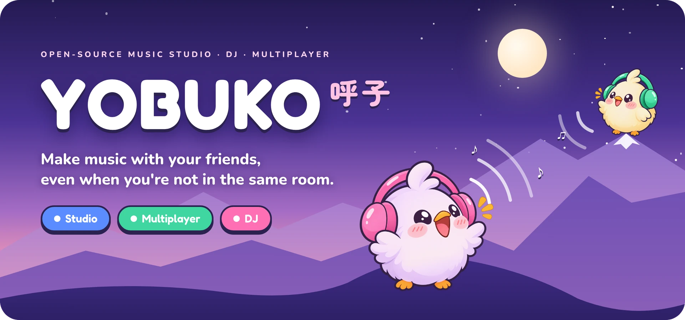
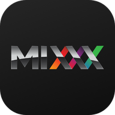
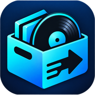
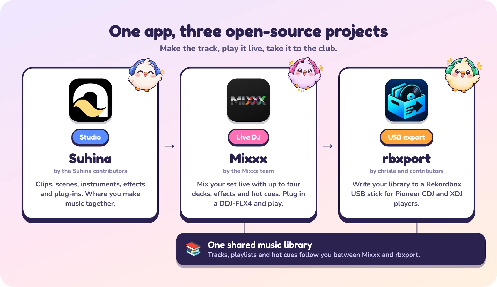
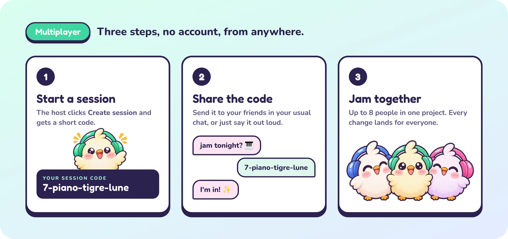
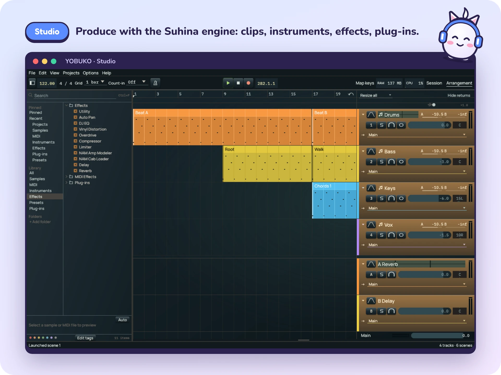
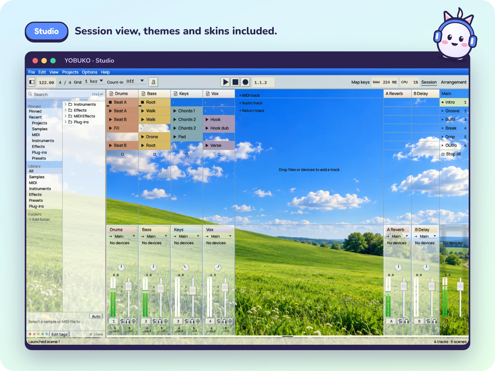
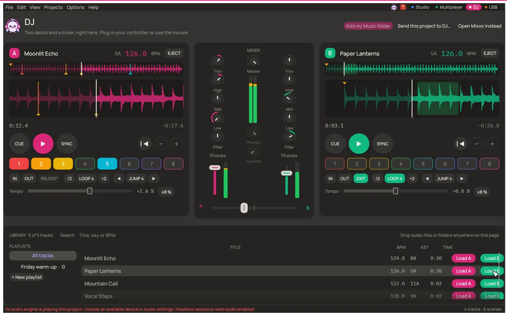
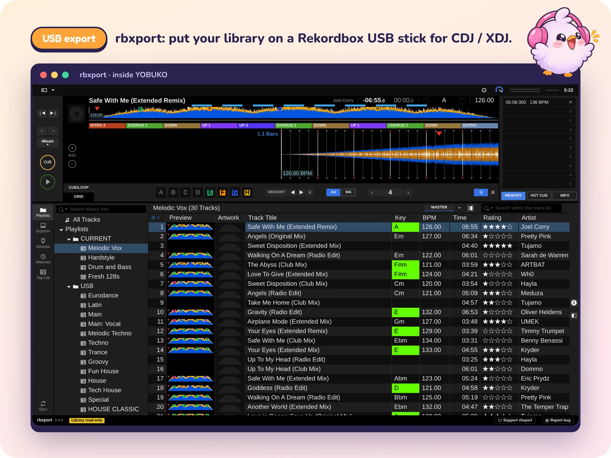

<p align="center">
  
</p>

<p align="center">
  <a href="https://github.com/Nozomagarion/YOBUKO/releases"></a>
  
  <a href="LICENSE"></a>
</p>

<br>

## 💜 Built on three wonderful open-source projects

<p>YOBUKO is a mix of three projects. It would not exist without them and their authors. <strong>Please go and give them a star first.</strong></p>

<table>
  <tr>
    <td width="33%" valign="top">
      <p align="center"><a href="https://github.com/suhina-daw/suhina-daw"></a></p>
      <h3 align="center"><a href="https://github.com/suhina-daw/suhina-daw">Suhina</a></h3>
      <p align="center"><strong>🎛️ The studio</strong></p>
      <p align="center">An open-source, clip-launching <strong>music studio written in Rust</strong>, in the spirit of Ableton Live. Its engine, instruments, effects and plug-in hosting are <strong>the whole Studio side of YOBUKO</strong>.</p>
      <p align="center"><a href="https://github.com/suhina-daw/suhina-daw"><code>suhina-daw/suhina-daw</code></a></p>
    </td>
    <td width="33%" valign="top">
      <p align="center"><a href="https://github.com/mixxxdj/mixxx"></a></p>
      <h3 align="center"><a href="https://github.com/mixxxdj/mixxx">Mixxx</a></h3>
      <p align="center"><strong>🎧 The live DJ</strong></p>
      <p align="center">The free DJ software <strong>by the Mixxx team</strong>: decks, effects, hot cues and mappings for hundreds of controllers. Ships with YOBUKO, one click from its own DJ decks.</p>
      <p align="center"><a href="https://github.com/mixxxdj/mixxx"><code>mixxxdj/mixxx</code></a></p>
    </td>
    <td width="33%" valign="top">
      <p align="center"><a href="https://github.com/chrisle/rbxport"></a></p>
      <h3 align="center"><a href="https://github.com/chrisle/rbxport">rbxport</a></h3>
      <p align="center"><strong>💾 The USB export</strong></p>
      <p align="center">A fast DJ library app <strong>by chrisle and contributors</strong>, with a real <strong>Rekordbox USB exporter</strong>. YOBUKO uses it to put your music on a stick for Pioneer CDJ / XDJ players.</p>
      <p align="center"><a href="https://github.com/chrisle/rbxport"><code>chrisle/rbxport</code></a></p>
    </td>
  </tr>
</table>

<p align="center"></p>

<sub>Their authors keep their copyright and credits. YOBUKO is an independent fork, not endorsed by any of these projects. More in <a href="#-credits-and-licence">Credits and licence</a>.</sub>

<br>

## 🎶 What YOBUKO is

**YOBUKO is about making music with your friends, even when you're not in the same room.**

One of you starts a session and reads out a short code. The others type it, and you are all in the same project, whether you live on the next street or on the other side of the country. Each person plays and listens on their own computer, and every change lands for everyone.

When the track is ready, switch to **DJ** mode: play it live on YOBUKO's own decks with your controller, or put it on a USB stick for the club's players with **rbxport**. **Make it together, play it live, take it to the club: one app.**

<br>

## 🤝 Multiplayer

<p align="center"></p>

- **No account, no server of ours.** Computers connect directly over the Internet, with public relays as a fallback.
- **Up to 8 people** in one session, with one short code.
- **Link playback** starts and stops everyone together.
- Shared notes, clips, tracks, mixer, built-in effects and plug-in settings. Audio can be shared too.
- Voice chat? Keep using the app you already love (Discord, etc.).

First time? Follow the **[multiplayer guide](GUIDE_MULTIPLAYER.md)**.

<br>

## 🎛️ Studio

<p align="center"></p>

<p align="center"></p>

The full Suhina studio: session and arrangement views, MIDI and audio tracks, instruments, effects, CLAP / VST3 / VST2 plug-ins and themes.

<br>

## 💿 DJ

<p align="center"></p>

**Mix live, right in YOBUKO.** Click the **DJ** tab at the top right: two decks and a mixer, in the same window as the studio.

- **The decks:** Cue, Play, Sync that lines up the beats, nudge, tempo (±8, ±16 or ±50 %), key lock and key change, key sync, quantize, tap tempo, 8 hot cues kept with each track, loops (in, out, reloop, beat loops) and beat jumps, on waveforms coloured by lows, mids and highs.
- **Effects and sampler:** two effect units with three effects each (echo, ping pong, reverb, filter, flanger, phaser, trans, autopan, bitcrusher, distortion, noise) in time with the music, on a deck or the master; an eight-slot sampler the pads can play.
- **Record, Auto DJ and the mic:** **REC** records your mix to a WAV file; **Auto DJ** plays a queue on its own, fading from each track's outro to the next one's intro; a **microphone** talks over the music, which ducks under it. The library keeps **crates** and a **history** of what you played, day by day.
- **The mixer:** trim, three-band EQ, filter, level and meter per deck, master level and meter, headphones with a cue/master blend, crossfader.
- **Four decks:** click **4 decks** for decks C and D, with four channels in the mixer and each deck on the left, right or middle of the crossfader.
- **The library:** search, sort by title, BPM, key or length, and playlists.
- **Plug in a Pioneer DDJ-FLX4 and play.** Play, Cue, Sync, Load, the faders, EQ, trim, filters, tempo, crossfader, jog wheels, loop buttons, TAP, the Beat FX section and the hot cue, beat loop, beat jump and sampler pads drive the decks, nothing to set up.
- **Your music:** drop audio files or folders on the page, or click **Add my Music folder**. Finished a track in the studio? **Send this project to DJ…**
- **Prefer Mixxx?** **Open Mixxx instead** starts Mixxx, which comes inside YOBUKO on macOS (Apple Silicon) and Windows, with its hundreds of controller mappings.

<p align="center"></p>

**Take it to the club with rbxport.** Click the **USB** tab, then **Open rbxport**, to write your music, playlists and cues to a Rekordbox stick for Pioneer CDJ / XDJ players.

### 📚 One music library for both

| You do this | YOBUKO does this |
|---|---|
| Add tracks, playlists or crates in **Mixxx** | They appear in rbxport, in a **Mixxx** folder, ready for the USB stick |
| Make playlists in **rbxport** | They appear in Mixxx as **rbxport · Folder / Name**, with hot cues and loops |
| Finish a track in the **Studio** | **Send this project to DJ…** puts it in your DJ library |

<br>

## ⬇️ Download

Grab the latest version from the **[Releases page](https://github.com/Nozomagarion/YOBUKO/releases)**.

| | System | File | How to install |
|:-:|---|---|---|
| 🍎 | macOS 11+ (Apple Silicon and Intel) | `YOBUKO-Mac.dmg` | Open it and drag **YOBUKO** into **Applications**. First launch: right-click › **Open** › **Open**. |
| 🪟 | Windows 10 / 11 | `YOBUKO-Windows-Setup.exe` | Run it. If SmartScreen warns you: **More info** › **Run anyway**. |
| 🐧 | Linux (most distributions) | `YOBUKO-…-x86_64.AppImage` | Make it executable, then double-click it. |
| 🐧 | Debian, Ubuntu, Mint… | `yobuko_…_amd64.deb` | Install it, and YOBUKO appears in your menu. |

> [!NOTE]
> Everyone in a session needs **the same version**. The apps are not signed by Apple or Microsoft yet, which is why you see a warning the first time you open them.

<br>

## 🏔️ Why "YOBUKO"?

In Japanese folklore, **Yamabiko (山彦)** is the spirit of the echo: a little mountain yōkai that answers whoever calls into the valley. In some regions it was also called **yobuko (呼子)**, *"the calling child"*.

That is exactly the idea here: **one musician sends out a sound, another one answers**, wherever they are.

<p align="center"></p>

Our mascots are three little birds who call and answer each other across the mountains. Their headphones match the three modes: 💙 Studio, 💚 Multiplayer and 🩷 DJ.

<br>

## 🧪 Where the project stands

YOBUKO is an **experimental prototype**, built one tested step at a time.

<!-- fork-progress:begin -->
| Area | Steps done | Next goal |
|---|---:|---|
| Create together | 17 / 18 | Real test on two computers |
| Prepare and perform | 9 / 10 | USB export and hardware compatibility |
| Evolve together | 4 / 7 | Common version validated on every platform |
<!-- fork-progress:end -->

These numbers count the steps listed in [fork-progress.json](fork-progress.json). They are not a percentage of the work left. Day-to-day progress lives in [PROGRESS.md](PROGRESS.md).

<details>
<summary><strong>What has been tested, and what has not yet</strong></summary>
<br>

- ✅ Online sessions with one short code were run between GitHub machines on **Linux, macOS and Windows**.
- ✅ Shared notes, clips, tracks and audio are covered by local network, desktop and audio tests.
- ⏳ **A session between two real homes** is the next acceptance step.
- ⏳ USB export has not been tried on a real CDJ yet.
- 🚧 Recording directly into a shared track, editing third-party plug-in knobs together and automatic tempo sync are future work.

Technical details: [online sessions](docs/spec/online-sessions.md) · [shared plug-ins](docs/spec/shared-plugins.md) · [network contract and limits](docs/spec/lan-starter-session.md) · [validation steps](docs/multiplayer-fork.md#try-the-desktop-prototype).

</details>

<details>
<summary><strong>How updates work</strong></summary>
<br>

```text
Suhina upstream ──┐
                  ├─ isolated integration ─ checks ─ combined build ─ in-app update
rbxport upstream ─┘            ↑                          ↑
                    YOBUKO multiplayer + DJ modules     pinned Mixxx release
```

Updates from Suhina and rbxport are merged into YOBUKO and tested together before a release, and Mixxx ships as a pinned official release. Installed apps only download that tested combined package; they never replace themselves with an official standalone app. Internal names (`suhina-*` crates and binaries) are kept so upstream updates keep merging cleanly. [Distribution design](docs/fork-distribution.md)

</details>

<details>
<summary><strong>Build it yourself</strong></summary>
<br>

The default branch holds the combined app. `main` stays an exact mirror of upstream Suhina.

```sh
git clone https://github.com/Nozomagarion/YOBUKO.git
cd YOBUKO
cargo test --locked -p suhina-collaboration -p suhina-multiplayer -p suhina-dj -p suhina-update
cargo build --locked -p suhina -p suhina-cli -p suhina-plugin-host
```

Platform prerequisites are in [Suhina's build instructions](UPSTREAM_README.md#building). Development builds are available from the [fork workflow runs](https://github.com/Nozomagarion/YOBUKO/actions/workflows/multiplayer-ci.yml).

</details>

<br>

## 🙌 Help shape it

The most useful help right now: **real sessions between two homes**, DJ preparation feedback and clear bug reports (your OS, the version, the exact steps, what you expected and what happened).

Please follow [CONTRIBUTING.md](CONTRIBUTING.md) and the [security notes](docs/security/session-sharing.md), and keep session codes private. Discuss YOBUKO here, on this fork: Suhina, Mixxx and rbxport have their own direction and rules.

<br>

## 📜 Credits and licence

| Project | What comes from it | What YOBUKO adds |
|---|---|---|
| **[Suhina](https://github.com/suhina-daw/suhina-daw)** | The music studio: native interface, audio engine, project model, instruments, effects, plug-in hosting, CLI and automation. | Online multiplayer, the DJ bridge and the combined distribution. |
| **[Mixxx](https://github.com/mixxxdj/mixxx)** by **the Mixxx team** | The Mixxx DJ application (GPL-2.0-or-later), shipped as YOBUKO's live DJ mode, and the community DDJ-FLX4 mapping by [ElHanko](https://github.com/ElHanko/mixxx-ddj-flx4-mapping) (MIT). | YOBUKO opens Mixxx from its DJ tab, installs the FLX4 mapping and keeps its library in sync with rbxport. |
| **[rbxport](https://github.com/chrisle/rbxport)** by **chrisle and contributors** | The rbxport desktop app (library, analysis, USB export, PRO DJ LINK) and its analysis and Rekordbox USB export libraries. | rbxport ships inside YOBUKO for USB export, and shares its library with Mixxx. |

Read [Suhina's original README](UPSTREAM_README.md), [ATTRIBUTION.md](ATTRIBUTION.md), [NOTICE](NOTICE), the rbxport provenance files ([analysis](third_party/rbxport-analysis/VENDORED.md), [exporter](third_party/rbxport-export/VENDORED.md), [app](third_party/rbxport-app/VENDORED.md)) and the exact [source pins](fork-sources.json). Original authors keep their copyright. This is an independent experimental fork, not an official release or endorsement from any of these projects, and it contains no proprietary music-software code or content.

**GPL-3.0-or-later.** Packages include the required notices and source. See [LICENSE](LICENSE) and the [distribution contract](docs/fork-distribution.md).

<br>

<p align="center"><sub>The Mixxx screenshot uses demo tracks made for this page; the rbxport screenshot shows its built-in demo library; the Studio screenshots show Suhina's themes.</sub></p>
