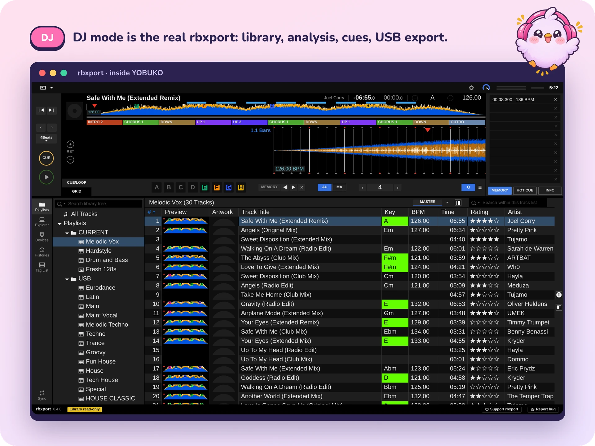

<p align="center">
  
</p>

<p align="center">
  <a href="https://github.com/Nozomagarion/YOBUKO/releases"></a>
  
  <a href="LICENSE"></a>
</p>

<br>

## 💜 Built on two wonderful open-source projects

<p>YOBUKO would not exist without these two projects and their authors. <strong>Please go and give them a star first.</strong></p>

<table>
  <tr>
    <td width="50%" valign="top">
      <p align="center"><a href="https://github.com/suhina-daw/suhina-daw"></a></p>
      <h3 align="center"><a href="https://github.com/suhina-daw/suhina-daw">Suhina</a></h3>
      <p align="center">An open-source, native, clip-launching <strong>music studio written in Rust</strong>, in the spirit of Ableton Live. Its engine, interface, instruments, effects and plug-in hosting are <strong>the whole Studio side of YOBUKO</strong>.</p>
      <p align="center"><a href="https://github.com/suhina-daw/suhina-daw"><code>github.com/suhina-daw/suhina-daw</code></a></p>
    </td>
    <td width="50%" valign="top">
      <p align="center"><a href="https://github.com/chrisle/rbxport"></a></p>
      <h3 align="center"><a href="https://github.com/chrisle/rbxport">rbxport</a></h3>
      <p align="center">By <strong>chrisle and contributors</strong>: a fast DJ library app with track analysis, cue points and a real <strong>Rekordbox USB exporter</strong> for Pioneer CDJ/XDJ players. <strong>YOBUKO's DJ mode is rbxport itself</strong>, shipped inside YOBUKO.</p>
      <p align="center"><a href="https://github.com/chrisle/rbxport"><code>github.com/chrisle/rbxport</code></a></p>
    </td>
  </tr>
</table>

<sub>Their authors keep their copyright and credits. YOBUKO is an independent fork, not endorsed by either project. More in <a href="#-credits-and-licence">Credits and licence</a>.</sub>

<br>

## 🎶 What YOBUKO is

**YOBUKO is about making music with your friends, even when you're not in the same room.**

One of you starts a session and reads out a short code. The others type it, and you are all in the same project, whether you live on the next street or on the other side of the country. Each person plays and listens on their own computer, and every change lands for everyone.

When the track is ready, switch to **DJ** mode to prepare it for your set and put it on a USB stick for the club's players. **Make it together, prepare the set, play it live: one app.**

<br>

## 🤝 Multiplayer

<p align="center"></p>

- **No account, no server of ours.** Computers connect directly over the Internet, with public relays as a fallback.
- **Up to 8 people** in one session, with one short code.
- **Link playback** starts and stops everyone together.
- Shared notes, clips, tracks, mixer, built-in effects and plug-in settings. Audio can be shared too.
- Voice chat? Keep using the app you already love (Discord, etc.).

First time? Follow the **[multiplayer guide](GUIDE_MULTIPLAYER.md)**.

<br>

## 🎛️ Studio

<p align="center"></p>

<p align="center"></p>

The full Suhina studio: session and arrangement views, MIDI and audio tracks, instruments, effects, CLAP / VST3 / VST2 plug-ins and themes.

<br>

## 💿 DJ

<p align="center"></p>

- Click the mode pill at the top right and pick **DJ**: the real **rbxport** opens.
- **Send this project to rbxport** puts your finished track straight into your DJ collection.
- Analyse tempo and key, set cue points, build playlists and **export to a Rekordbox USB stick** for CDJ / XDJ players.

<br>

## ⬇️ Download

Grab the latest version from the **[Releases page](https://github.com/Nozomagarion/YOBUKO/releases)**.

| | System | File | How to install |
|:-:|---|---|---|
| 🍎 | macOS 11+ (Apple Silicon and Intel) | `YOBUKO-Mac.dmg` | Open it and drag **YOBUKO** into **Applications**. First launch: right-click › **Open** › **Open**. |
| 🪟 | Windows 10 / 11 | `YOBUKO-Windows-Setup.exe` | Run it. If SmartScreen warns you: **More info** › **Run anyway**. |
| 🐧 | Linux (most distributions) | `YOBUKO-…-x86_64.AppImage` | Make it executable, then double-click it. |
| 🐧 | Debian, Ubuntu, Mint… | `yobuko_…_amd64.deb` | Install it, and YOBUKO appears in your menu. |

> [!NOTE]
> Everyone in a session needs **the same version**. The apps are not signed by Apple or Microsoft yet, which is why you see a warning the first time you open them.

<br>

## 🏔️ Why "YOBUKO"?

In Japanese folklore, **Yamabiko (山彦)** is the spirit of the echo: a little mountain yōkai that answers whoever calls into the valley. In some regions it was also called **yobuko (呼子)**, *"the calling child"*.

That is exactly the idea here: **one musician sends out a sound, another one answers**, wherever they are.

<p align="center"></p>

Our mascots are three little birds who call and answer each other across the mountains. Their headphones match the three modes: 💙 Studio, 💚 Multiplayer and 🩷 DJ.

<br>

## 🧪 Where the project stands

YOBUKO is an **experimental prototype**, built one tested step at a time.

<!-- fork-progress:begin -->
| Area | Steps done | Next goal |
|---|---:|---|
| Create together | 17 / 18 | Real test on two computers |
| Prepare and perform | 9 / 10 | USB export and hardware compatibility |
| Evolve together | 4 / 7 | Common version validated on every platform |
<!-- fork-progress:end -->

These numbers count the steps listed in [fork-progress.json](fork-progress.json). They are not a percentage of the work left. Day-to-day progress lives in [PROGRESS.md](PROGRESS.md).

<details>
<summary><strong>What has been tested, and what has not yet</strong></summary>
<br>

- ✅ Online sessions with one short code were run between GitHub machines on **Linux, macOS and Windows**.
- ✅ Shared notes, clips, tracks and audio are covered by local network, desktop and audio tests.
- ⏳ **A session between two real homes** is the next acceptance step.
- ⏳ USB export has not been tried on a real CDJ yet.
- 🚧 Recording directly into a shared track, editing third-party plug-in knobs together and automatic tempo sync are future work.

Technical details: [online sessions](docs/spec/online-sessions.md) · [shared plug-ins](docs/spec/shared-plugins.md) · [network contract and limits](docs/spec/lan-starter-session.md) · [validation steps](docs/multiplayer-fork.md#try-the-desktop-prototype).

</details>

<details>
<summary><strong>How updates work</strong></summary>
<br>

```text
Suhina upstream ──┐
                  ├─ isolated integration ─ checks ─ combined build ─ in-app update
rbxport upstream ─┘            ↑
                    YOBUKO multiplayer + DJ modules
```

Updates from Suhina and rbxport are merged into YOBUKO and tested together before a release. Installed apps only download that tested combined package; they never replace themselves with an official standalone app. Internal names (`suhina-*` crates and binaries) are kept so upstream updates keep merging cleanly. [Distribution design](docs/fork-distribution.md)

</details>

<details>
<summary><strong>Build it yourself</strong></summary>
<br>

The default branch holds the combined app. `main` stays an exact mirror of upstream Suhina.

```sh
git clone https://github.com/Nozomagarion/YOBUKO.git
cd YOBUKO
cargo test --locked -p suhina-collaboration -p suhina-multiplayer -p suhina-dj -p suhina-update
cargo build --locked -p suhina -p suhina-cli -p suhina-plugin-host
```

Platform prerequisites are in [Suhina's build instructions](UPSTREAM_README.md#building). Development builds are available from the [fork workflow runs](https://github.com/Nozomagarion/YOBUKO/actions/workflows/multiplayer-ci.yml).

</details>

<br>

## 🙌 Help shape it

The most useful help right now: **real sessions between two homes**, DJ preparation feedback and clear bug reports (your OS, the version, the exact steps, what you expected and what happened).

Please follow [CONTRIBUTING.md](CONTRIBUTING.md) and the [security notes](docs/security/session-sharing.md), and keep session codes private. Discuss YOBUKO here, on this fork: Suhina and rbxport have their own direction and rules.

<br>

## 📜 Credits and licence

| Project | What comes from it | What YOBUKO adds |
|---|---|---|
| **[Suhina](https://github.com/suhina-daw/suhina-daw)** | The music studio: native interface, audio engine, project model, instruments, effects, plug-in hosting, CLI and automation. | Online multiplayer, the DJ bridge and the combined distribution. |
| **[rbxport](https://github.com/chrisle/rbxport)** by **chrisle and contributors** | The whole rbxport desktop app (library, analysis, decks, USB export, PRO DJ LINK) and its analysis and Rekordbox USB export libraries. | rbxport ships inside YOBUKO as its DJ mode; "Send this project to rbxport" adds a render to its collection. |

Read [Suhina's original README](UPSTREAM_README.md), [ATTRIBUTION.md](ATTRIBUTION.md), [NOTICE](NOTICE), the rbxport provenance files ([analysis](third_party/rbxport-analysis/VENDORED.md), [exporter](third_party/rbxport-export/VENDORED.md), [app](third_party/rbxport-app/VENDORED.md)) and the exact [source pins](fork-sources.json). Original authors keep their copyright. This is an independent experimental fork, not an official release or endorsement from either project, and it contains no proprietary music-software code or content.

**GPL-3.0-or-later.** Packages include the required notices and source. See [LICENSE](LICENSE) and the [distribution contract](docs/fork-distribution.md).

<br>

<p align="center"><sub>The DJ screenshot shows rbxport's built-in demo library. The Studio screenshots show Suhina's themes.</sub></p>
