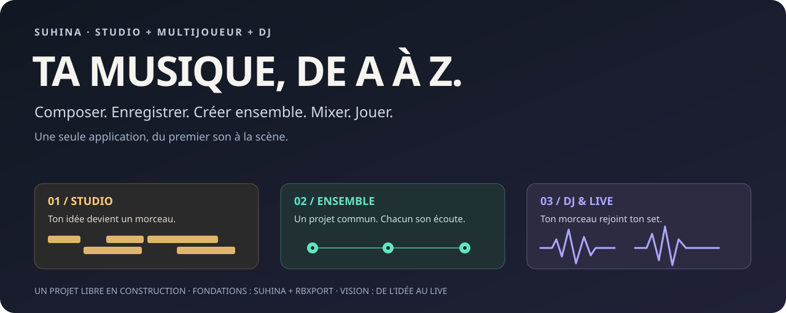
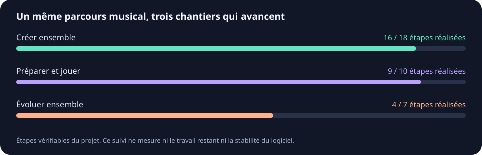

<p align="center">
  
</p>

<h1 align="center">Studio + Multijoueur + DJ</h1>
<p align="center"><strong>Une seule application, du premier son au dernier morceau de ton set.</strong></p>

<p align="center">
  <a href="#la-vision"></a>
  <a href="#créer-à-plusieurs"></a>
  <a href="#préparer-et-jouer-son-set"></a>
</p>

<p align="center"><a href="#la-vision">La vision</a> · <a href="#où-en-est-le-projet">Avancement</a> · <a href="#essayer-la-version-actuelle">Essayer</a> · <a href="#les-projets-qui-rendent-cela-possible">Suhina &amp; rbxport</a> · <a href="README.en.md">English / technical overview</a></p>

## La vision

**Je construis le logiciel dans lequel j'aimerais faire toute ma musique.**

L'idée : réunir **la production musicale dans l'esprit d'Ableton Live**, **la création à
plusieurs** et **la préparation DJ apportée par rbxport**, dans une seule et même application.
Le socle de production est le logiciel libre **Suhina**. Le multijoueur et la liaison entre
studio et DJ sont les ajouts de ce projet.

Composer une idée, enregistrer une prise, construire un morceau avec ses amis, le mixer,
préparer son set et le jouer en live : garder le même fil du début à la fin.

> **Un studio pour créer. Un espace commun pour avancer ensemble. Un espace DJ pour emmener
> sa musique sur scène.**

Le projet est en développement. Cette page présente sa destination, puis distingue ce qui
fonctionne aujourd'hui de ce qui reste à construire. La partie DJ n'intègre actuellement que
le module d'analyse de rbxport ; ses autres fonctions viendront progressivement.

## De l'idée au live

| Imaginer | Produire | Créer ensemble | Préparer | Jouer |
|---|---|---|---|---|
| Poser une mélodie, un rythme, une ambiance. | Enregistrer, arranger, travailler le son et mixer son morceau. | Construire un projet commun tout en gardant sa propre écoute. | Retrouver ses rendus, analyser les morceaux et organiser son set. | Passer de la création au live et au mix DJ. |

**C'est le parcours que je veux réunir dans une seule app.** Les instruments, effets,
plugins, clips et outils de production reposent sur le travail de Suhina. Ce fork construit
les ponts vers la collaboration et le DJ, avec une interface et une distribution communes.

### Produire sa musique

Un vrai espace de création : pistes audio et MIDI, instruments, effets, clips, arrangement,
enregistrement et rendu. Le moteur et les outils de Suhina donnent les fondations du studio.
L'objectif est de pouvoir développer un morceau complet et l'emmener jusqu'à sa préparation
pour le live, en conservant le lien avec son projet d'origine.

### Créer à plusieurs

Avancer sur la même musique avec ses amis. Pouvoir travailler sur un projet partagé tout en
écoutant une autre partie du morceau que les autres : chacun garde sa lecture et sa position.

Le premier prototype relie un hôte et un invité sur le réseau local. La suite visée est
l'édition commune des notes et clips, le partage des fichiers du projet et des enregistrements.

### Préparer et jouer son set

Passer du morceau que l'on produit au morceau que l'on joue. Une bibliothèque DJ dans la même
application, l'analyse du tempo et de la tonalité, puis les playlists, points cue, grilles
rythmiques et outils de performance.

rbxport apporte une base libre pour cette direction. Aujourd'hui, son analyse est intégrée à
la bibliothèque et un rendu du studio peut y être ajouté. Les fonctions de préparation avancée,
les platines et l'export vers le matériel DJ restent à construire et à vérifier.

## Où en est le projet



<!-- fork-progress:begin -->
| Partie du projet | Étapes réalisées | Prochain objectif |
|---|---:|---|
| Créer ensemble | 4 / 9 | Essai réel sur deux ordinateurs |
| Préparer et jouer | 4 / 8 | Playlists et préparation de set |
| Évoluer ensemble | 4 / 7 | Version commune validée sur toutes les plateformes |
<!-- fork-progress:end -->

Les barres comptent les étapes listées dans [fork-progress.json](fork-progress.json), avec des
liens vers le code ou les vérifications. Elles ne représentent pas un pourcentage de réalisation
du logiciel final, ni une estimation du travail restant. Les fonctions héritées de Suhina ont
leur [propre suivi](UPSTREAM_README.md) : elles ne sont pas réattribuées à ce fork.

| Partie | Disponible dans le prototype | Prochaine étape |
|---|---|---|
| **Studio** | Le socle Suhina et son espace de production ; rendu d'un projet vers la bibliothèque DJ. | Approfondir les liens entre projet, collaboration et préparation du set. |
| **Multijoueur** | Session LAN hôte + invité, quatre pistes MIDI générées, noms/volumes/panoramiques partagés, lectures indépendantes. | Essai sur deux ordinateurs physiques, puis partage des vrais projets et de leurs fichiers. |
| **DJ** | Bibliothèque audio persistante, import et analyse tempo/tonalité issue de rbxport. | Playlists, points cue, grilles rythmiques, platines et compatibilité matérielle. |
| **Mises à jour** | Comparaison des sources GitHub dans les paramètres, outils d'intégration et vérification d'un paquet commun. | Valider et publier le canal commun, puis activer l'intégration périodique. |

Le trafic chiffré est testé entre deux services sur le même ordinateur, avec des vérifications
sur deux projets de bureau et des moteurs audio indépendants. **Le test sur deux ordinateurs
physiques reste à faire.** Les projets personnels, fichiers audio, notes, clips, plugins et
prises micro ne sont pas encore échangés par le multijoueur.

## Essayer la version actuelle

Le dépôt s’ouvre directement sur **`feature/multiplayer`**, la branche de cette application.
La branche `main` reste le miroir intact du projet Suhina d’origine. [Ouvrir la branche du projet](https://github.com/Nozomagarion/suhina-daw/tree/feature/multiplayer#readme)
pour voir cette présentation et les ajouts.

Dans l'application, trois accès : **Studio**, **Multiplayer** et **DJ**.

1. Ouvrir **Multiplayer**, puis **Create LAN session** sur l'ordinateur hôte.
2. Copier l'invitation privée avec **Copy invitation**.
3. Sur l'autre instance, coller l'invitation puis choisir **Join LAN session**.
4. Modifier un nom, un volume ou un panoramique et l'appliquer. Chacun utilise **Play locally**
   et **Stop locally** pour son écoute. **Leave session** conserve le projet en local.

Ce premier essai génère sa propre musique : aucun projet personnel n'est nécessaire.
Les [instructions détaillées](docs/multiplayer-fork.md#try-the-desktop-lan-prototype) expliquent
les adresses réseau et les limites de ce prototype.

Les paquets de développement proviennent des [contrôles GitHub du fork](https://github.com/Nozomagarion/suhina-daw/actions/workflows/multiplayer-ci.yml?query=branch%3Afeature%2Fmultiplayer).
Vérifier le commit et le résultat de sa plateforme. Le canal public commun n'est pas encore
publié ; ce projet ne propose pas encore une distribution stable.

## La même app pour tout le groupe

Le but est que chacun installe la même version et conserve le studio, le multijoueur et le DJ
lors des mises à jour de Suhina ou de rbxport.

```text
Nouveautés Suhina ───┐
                    ├── Intégration avec nos ajouts ── Tests ── Nouvelle version commune
Nouveautés rbxport ──┘                                              │
                                                          Mise à jour dans l'app
```

Les sources sont suivies par version. Les nouveautés passent d'abord dans une intégration
isolée avec nos modules, puis dans les vérifications avant publication. Les conflits sont
résolus à cette étape. Les amis installent ensuite le paquet combiné validé.

Le bouton **Settings → General → GitHub updates…** compare les sources et cherche une version
commune disponible. La récupération périodique et la publication commune restent à activer.
[Comment les mises à jour sont préparées](docs/fork-distribution.md).

## Les projets qui rendent cela possible

**Ce logiciel se construit grâce au travail de deux projets libres et de leurs auteurs.**

| Fondation | Apport au projet |
|---|---|
| **[Suhina](https://github.com/suhina-daw/suhina-daw)** et ses contributeurs | Le logiciel de production : interface native, moteur audio, projets, instruments, effets, hébergement des plugins et outils de création. C'est la fondation du studio. |
| **[rbxport](https://github.com/chrisle/rbxport)**, par chrisle et ses contributeurs | Le module `rbl-analysis` utilisé ici pour l'analyse du tempo et de la tonalité. Il fournit une première brique vers la préparation DJ ; le reste de rbxport n'est pas encore intégré. |
| **Ce fork** | La collaboration, l'espace DJ relié au studio, la présentation d'un parcours musical commun et les outils pour distribuer l'ensemble sans perdre ces ajouts. |

Les auteurs d'origine conservent leurs crédits et leurs droits. Voir le
[README original de Suhina](UPSTREAM_README.md), [ATTRIBUTION.md](ATTRIBUTION.md), [NOTICE](NOTICE),
la [provenance du code rbxport](third_party/rbxport-analysis/VENDORED.md) et les
[versions intégrées](fork-sources.json).

La référence à Ableton Live décrit l'idée de workflow recherchée. Le code du studio provient de
Suhina ; aucun code d'Ableton n'est intégré. Ce projet est indépendant et n'est affilié ni à
Ableton AG, ni aux équipes officielles de Suhina ou de rbxport. Les marques appartiennent à
leurs propriétaires.

## Construire et contribuer

```sh
git clone --branch feature/multiplayer https://github.com/Nozomagarion/suhina-daw.git
cd suhina-daw
cargo test --locked -p suhina-collaboration -p suhina-multiplayer -p suhina-dj -p suhina-update
cargo build --locked -p suhina -p suhina-cli -p suhina-plugin-host
```

[Prérequis de compilation](UPSTREAM_README.md#building) · [Guide du fork](docs/multiplayer-fork.md) ·
[Contrat du prototype LAN](docs/spec/lan-starter-session.md) · [Limites de sécurité](docs/security/session-sharing.md)

Les prochaines contributions utiles concernent les essais sur deux ordinateurs, les projets et
fichiers partagés, l'édition commune des notes/clips et la préparation DJ. Pour un retour de bug,
préciser le système, le commit, les étapes et le résultat attendu/observé. Garder les invitations
privées. Suivre [CONTRIBUTING.md](CONTRIBUTING.md) et discuter les ajouts de ce fork ici.

**Logiciel libre — GPL-3.0-or-later.** Conserver les crédits, notices et sources correspondantes
dans les distributions. Voir [LICENSE](LICENSE) et le [contrat de distribution](docs/fork-distribution.md).
