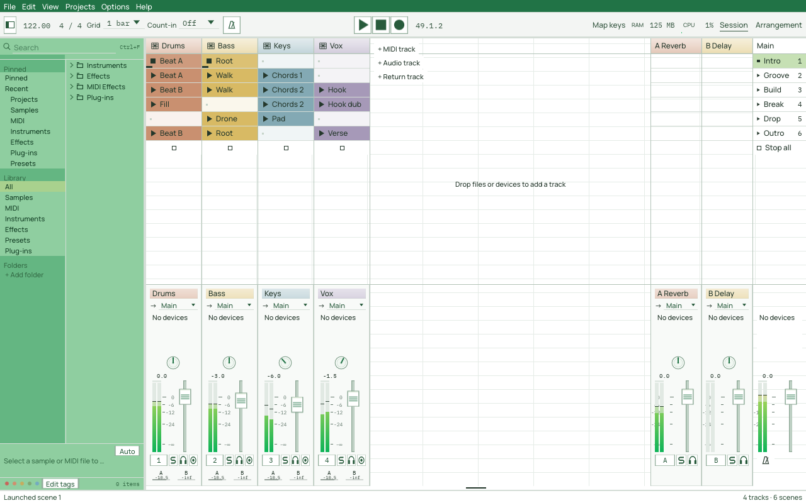
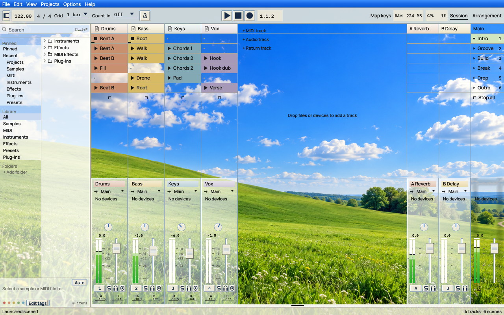
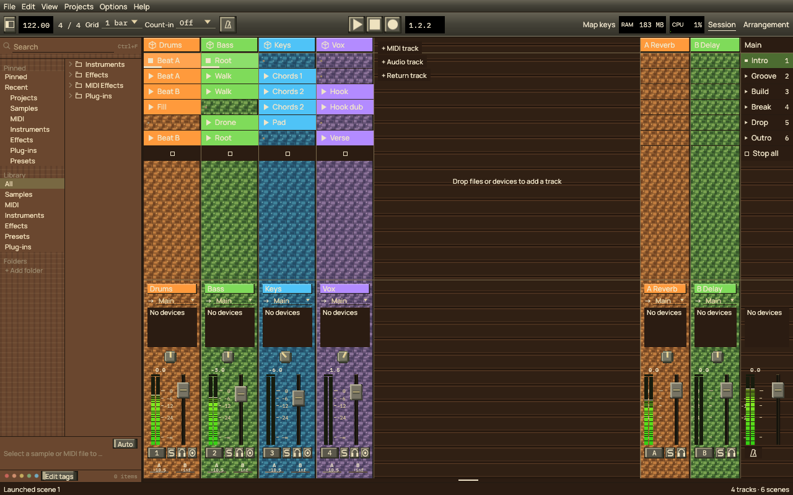

Toolbar editing keeps the real native controls and their layout visible. Entering or
leaving the editor without a change must not create a toolbar layout or change the
theme. An overlay outlines draggable modules over an 8-point snap grid; dragging
changes a horizontal offset from the existing native or CSS anchor. Native centre
and right anchors therefore keep responding to window resizing. Done commits the
draft to the theme; Cancel or Escape discards it. The controls cannot issue commands
while the overlay is active. `skin.toolbar-offsets` stores bounded integer offsets
by module id independently of the optional ordered toolbar layout.

The interaction reference requested by the user is World of Warcraft's Edit Mode:
edit the visible interface through selection outlines and alignment guides rather
than replacing it with abstract layout blocks. This is an independent Suhina
interaction specification based on the supplied screenshots and the public
[EditModeExpanded description](https://github.com/teelolws/EditModeExpanded/blob/main/README.md)
(read 2026-10-22), which describes moving visible frames and saving their positions.
That description is an add-on author's account, not official documentation of
Blizzard's grid implementation. No third-party source or artwork is reused.
Canonical native CSS mirrors offsets as `toolbar { offset-transport: 80px; }`.

SVG inheritance resolves each control role in this order: theme state artwork,
theme base artwork, shared default state artwork, shared default base artwork.
Suhina ships original default SVG files under `assets/themes/default/`, embeds
the same files for reliable startup, and creates a protected reference library under
`themes/_defaults/assets/` plus an importable `themes/_defaults/suhina-default.zip`.
Missing files are recreated from the embedded sources, including when the ZIP is
also missing. A changed or corrupt backup ZIP is preserved separately before
rebuilding the pristine archive. Editing default artwork first creates a complete numbered user theme
named `Suhina Default (modified N)`; only after that copy commits are the reference
files restored. The new theme appears in the gallery without changing another
theme's selected identity. Malformed bounded edits are archived in an exports
recovery ZIP before restoration. Oversized or inaccessible files are left untouched
with a warning; the renderer always uses its embedded default. Themes store only their explicit artwork overrides. Portable
exports include inherited artwork so they keep their appearance on another machine.
The current theme's palette supplies `currentColor`; inheritance does not force
the default theme's colours. Deleting an override restores inheritance.

Every theme package contains a generated `README.md` for human and AI-assisted
authors, shared with the template export. Multi-theme backups also carry it at
the archive root. The guide explains what/why/how/when, current possibilities,
file ownership, examples, SVG inheritance and recovery, supported CSS integration
and explicit limits. Its palette reference is generated from the token registry.

# Theme skins

## Session density and meter materials

The original **Suhina Sheet** built-in theme demonstrates a light spreadsheet-like
Session, green application chrome, compact cells and square controls. Its own
self-contained SVG artwork lives under `assets/themes/sheet/` and is embedded with
the palette and CSS, so duplication/export includes the effective artwork without
depending on installed files. It uses existing native controls, commands and views;
it does not add spreadsheet functions or bundle third-party application artwork.
The menu, toolbar and native Windows application bar enter their style scopes
before painting their backgrounds, so their solid colours and CSS materials agree
with the scoped foregrounds without changing layout or menu/transport actions.



This is an actual native Linux/OpenGL capture with the detail area hidden and demo
playback providing the meter levels. The empty-space worksheet grid is decorative;
clip launch, faders, pan, scenes and routing retain their native behavior.

**Suhina Meadow** adds classic blue chrome, cream beveled controls and paper-like
browser/device surfaces over a green-hill wallpaper. The landscape is an original
AI-generated image, not a bundled operating-system photograph. Its PNG is embedded
once and shared across theme instances; export writes it as editable `background.png`.
The theme leaves the empty workspace transparent over this private image, with
translucent blue/cream glass panels and theme-owned liquid strengths (panels 48,
tracks 24, clips 12). The liquid renderer requires GPU rendering, animations enabled
and encoded/linear texture-view support; older GL adapters retain ordinary alpha
materials without installing unsupported captures. Effective SVG roles include shared original Sheet
glyphs plus Meadow's own faders, knobs, button, paper icon and mixer body.
While a private background image is active, the workspace's separator backdrop
stays transparent. Panel surfaces and individual splitter controls still paint
their own fills; without an image the native separator backdrop remains unchanged.



This native Vulkan capture uses the original generated wallpaper, actual theme
liquid settings and measured demo levels. It was rendered with the software Vulkan
adapter in an isolated X11 session; it does not establish physical-GPU timing.

**Suhina Blocks** uses original brown plank/grain CSS, stone-like beveled controls
and colour-keyed pixel SVG textures. It has no landscape or background PNG. Native
`.track-column { --suhina-track-artwork: on; }` opts Session slot columns into the
existing `track.body` artwork (including raw colour/state variants). The body stays
behind clip cells; empty cells preserve it while hover/stop marks remain native.
`off` or omission retains the original slot fills. JSON/CSS/export preserve this
native style property, and it does not change launch/drop geometry or commands.



This native Vulkan Session capture uses original SVG pixel textures and CSS brown
planks. No landscape wallpaper or game artwork is used. Native replacement-alpha
surfaces leave textured empty slots untouched; hover paints as an ordinary overlay
so it cannot erase the underlying artwork.

Session and Arrangement remain separate views. Theme customization does not introduce
a combined view or the separately planned mixer view.

Optional `skin.session` dimensions change the native Session layout: `track-width`
and `return-width` (64–512 points), `scene-width` (64–512), `slot-height` (16–64),
`header-height` (20–64). Omitted values use native
geometry/preferences. Canonical CSS mirrors these as `session { track-width: 80px; }`
and the other named properties; `auto` removes an override. Mixer height continues
to use its existing native preference and divider.
Column widths affect scrolling, rendering, file/clip drop targets and hit testing
together. Individual control placement remains relative to these native anchors.
Canonical `.pan { --suhina-appearance: knob; }` stores a portable pan-face override
in `skin.styles` for both Session and Arrangement. `field` forces a value field;
`native` or no override retains the existing global preference. The compact example
includes the knob override; themes do not need to change the user's preference.
The fader's dB labels/ticks expose `mixer-volume-scale` separately from the rail/cap
and readout, with `.fader-scale` paint styling. Moving/hiding this scale does not
change the parameter or gesture. Horizontal faders retain a horizontal scale.

Meter material scopes include `.meter-vertical` and `.meter-horizontal`, containing
`.meter-level`. An authored level gradient is anchored to the full meter range,
then clipped to each measured peak/RMS extent (and each segment). It must not stretch
or change its signal thresholds as the measured level changes. Peak/RMS opacity
remains native. Outset shadows form the glow around the lit extent, preserving
empty rails, segment gaps and native clip/reset handling.

Mixer bodies and strip-name surfaces consume their `.mixer` and `.track-name`
background fills, gradients and shadows above fallback/SVG artwork. A solid CSS
background replaces the native colour tint; an alpha gradient may retain underlying
track artwork. Missing rules preserve the ordinary native colours.
An original [metallic cap SVG](../../assets/themes/examples/metal-fader.svg) is supplied
as optional authoring artwork; it does not replace the protected default. Reference it
as `fader.cap` in a user theme to combine it with the gloss material example.

## Native acceptance captures

The [compact gloss follow-up](../design/reference/theme-dark-gloss-compact.png) uses
86-point track columns, 80-point returns, 18-point slots, the existing 320-point
mixer height, a centred narrow pan knob, a separately positioned dB scale and the
optional original metallic cap SVG. The meter sits left of the fader. It demonstrates
the Session view alone; neither a combined Arrangement view nor a standalone mixer
view is introduced. The screenshot is from actual demo playback on the same isolated
Linux OpenGL/virtual-ALSA setup described below.

Its additional placement overrides are:

```css
.control-mixer-meter { left: -48px; }
.control-mixer-volume { left: 18px; }
.control-mixer-volume-scale { left: -40px; }
.control-mixer-volume-readout { left: -24px; width: 30px; }
.control-mixer-pan { left: 25px; width: 24px; height: 24px; }
.control-mixer-color { width: 2px; }
```

Load the compact native CSS and dark-gloss advanced CSS examples separately, then
apply these placements and the cap override. The compact example carries its pan style.
The capture keeps the global preference at Field and verifies the theme-owned Knob
override, so that presentation does not depend on another user's settings.
The images below retain the earlier, wider geometry and colour-keyed texture example.

These are unretouched captures of the native Linux application (Mesa/OpenGL on an
isolated test display), using original dark-gloss CSS and a small original colour-keyed
name texture. The detail panel is hidden and the existing native mixer/track resizing
is used to expose controls. They demonstrate implemented adapters, not complete
browser CSS support or a finished appearance for every theme.

- [Session, tall mixer and live vertical meters](../design/reference/theme-dark-gloss.png).
- [Horizontal faders/meters, names at the bottom and top-only colour stripes](../design/reference/theme-dark-gloss-horizontal.png).
- [Edit interface: actual controls beneath outlines and an 8-point grid](../design/reference/theme-interface-editor.png).
- [Arrangement, large native track rows and replaceable note glyphs](../design/reference/theme-dark-gloss-arrangement.png).

The Session meter captures use actual demo playback through a paced virtual ALSA
sink. They do not verify physical audio latency or supported desktop transparency;
the native GPU transparency regression has separate automated coverage. Theme
changes were made through external JSON/CSS files while the app remained open.
Colour-dependent texture contrast is authored with named scopes, e.g.
`.track-name[data-object=track-1] { color: #edf6e9; }`; arbitrary named track scopes
use `data-object`, while toolbar/workspace ids have their documented literal ids.

## Native element placement contract

The customization target includes every native control and text/name area, not just toolbar
modules. `skin.controls` is a bounded map (256 semantic names) whose entries specify native
anchor-relative `left`/`top` offsets, optional logical-point `width`/`height`, and a
`direction` (`vertical` or `horizontal`). `bottom` anchors to the containing panel's
bottom; `hidden` suppresses connected elements. `height: 100%` (editor **Full height**)
stretches between the panel's top plus `top` and bottom minus `bottom` (default zero).
In this mode `top` is a panel inset, not a native-anchor offset. Insets are clamped to
the panel; an exhausted height draws nothing. `height: auto` restores native height. Similarly `width: 100%` (**Full width**)
uses `left` and `right` insets; `right` can also anchor a fixed-width control.
`width: auto` restores native width.
Arrangement meter placement uses the whole track header, never its visible intersection;
scroll clipping affects painting and hit testing without changing the meter scale. The canonical CSS projection uses
`.control-NAME { left: 8px; top: 0px; width: 80px; height: 20px;
--suhina-direction: horizontal; }`. Offsets are bounded to ±16384, sizes to 1–4096.
Each adapter must resolve the rectangle before interaction and paint, preserve the native
widget ID/command, and contain it in its panel. Removing an override restores native geometry.
These are explicit native relative offsets, not a claim of general CSS positioning support.
Right-click the toolbar and choose **Edit interface** for measured native outlines and
an 8-point grid. Normal dragging also snaps to nearby edges and centres of other
controls in the same containing rectangle, with alignment guides. Shift-drag uses
one logical pixel steps while retaining peer alignment; Alt+Shift-drag is free
without grid or peer snapping.
Fractional offsets survive CSS and JSON storage at 1/1024 logical pixel resolution.
Alt alone retains normal snapping. Dragging creates no persistent peer anchor.
A persistent anchor is explicit: `--suhina-anchor-left|top|right|bottom:
<control> <edge> [<gap>px]` (JSON `anchors: { "bottom": "arrangement-volume top 4px" }`)
makes that edge follow the target's edge on the same axis. Opposite edges keep the gap
between the controls; matching edges inset by it. With one anchored edge a full-width or
full-height control keeps its other edge, otherwise it moves at its size; two anchored
edges set both. The target is resolved in the same container: drawn earlier in the frame,
or the previous frame's rectangle moved as far as the container moved (scrolling), with
one repaint when it has since changed. A hidden, absent or foreign target leaves the edge
at the control's own placement. Cycles, self-anchors and chains of more than eight links
are dropped with a warning when a theme loads and refused by the editor. Gaps are whole
points within ±16384; the result stays inside the container. The toolkit-independent
parts (names, parsing, validation, axis arithmetic) are `suhina_style::anchor`.
Drag an outline or select a semantic element and edit offsets, size,
bottom anchoring and direction. Matching instances share that theme rule. Done merges only
edited entries into the latest theme; Cancel/Escape discards the draft. A theme switch cancels
it. Entering/leaving without edits never forks a default theme. An input shield keeps the
underlying transport/mixer commands idle while placing controls; the editor window remains
above the shield. Native widget IDs remain unchanged.
The direction property applies to controls with an axis; horizontal volume dragging increases
to the right, while vertical dragging increases upwards. Keyboard, wheel, reset and undo keep
their existing semantics. Layout entry support is incremental and documented per adapter.

Artwork can choose an exact raw track colour and interaction state before palette tinting:
`track.name.color-00ff00.hover` overrides the default `track.name`. The most specific own
colour/state variant wins, then own colour, own state, own default, then embedded fallback.
`track.body` covers the strip background. A contiguous sequence of `.frame-0` through
`.frame-31` asset keys animates that variant at `skin.artwork-fps` (1–30, default 12).
Native animation-off freezes it at frame zero without a repaint loop. Assets allow the
base roles plus 64 variants; SVG parse, cache and package budgets still apply. MIDI/audio type glyphs have
their own SVG roles (`track.midi` and `track.audio`); MIDI defaults to a note symbol.

Arrangement headers also expose `arrangement-fold`, `arrangement-enable`,
`arrangement-automation`, `arrangement-output`, `arrangement-input`,
`arrangement-send-1` (and subsequent return slots), and previous/next send buttons.
Session send controls expose `mixer-send-1` and subsequent slots within the movable
sends region. Slot numbers follow native return order, independent of project ids.

Connected placement adapters currently include native/custom toolbar modules (`toolbar-NAME`),
transport play/stop/record/metronome, Session strip name, output/input/monitor block, devices,
sends, pan, volume/readout, meter, compact volume and toggle row (`mixer-NAME`), solo/cue/arm,
track-type glyphs, and Arrangement name, colour band, volume/pan and meter. `mixer-color` can
hide the side band or make it a top stripe; `mixer-name { bottom: 0px; }` relocates the name.
Compact native height thresholds remain authoritative. Full raw-widget, clip/scene, browser
and floating-window geometry coverage remains necessary for the all-elements target.

SDK device controls use `device-<control-id>` placement names. Their drawing coordinates,
hit rectangles and parameter gestures move together. Explicit dimensions scale rectangles,
paths, curves and textures on both axes; text/strokes use the smaller scale and knobs retain
their circular shape. Invalid/long identifier characters get a bounded stable slug/hash name.
The native device panel remains the containing clip and each control keeps its existing ID,
parameter bindings and visibility condition. Disabled/hidden device controls do not dispatch
parameter actions. The native volume-direction property does not reinterpret SDK bindings.

On the native see-through surface host, SVG background roles clear their covered region
before compositing the texture so a background's alpha is written once. The opaque/OpenGL
path, floating layers and an active private background image retain normal blending. Native
fallback fills use the shared `Backgrounds` path. Scoped authored foregrounds also cover the
independent `text.inverse` role; selected fills use `control.selectedBackground`.

Artwork roles and frames also accept package-relative PNGs or embedded PNG data URLs.
PNG decoding is off the audio callback and bounded to 8 MiB per file, 4096 pixels per
dimension, four million pixels and 16 MiB of decoded allocation. The combined inline
artwork payload is bounded to 16 MiB, checked progressively as package resources resolve.
SVG remains strictly self-contained vector markup. Portable packages retain each image's
format; missing roles still inherit the original SVG. A revision/role source-hash cache
avoids hashing large PNG data on every repaint; rendered textures retain the existing
64-entry/1024-square budget and invalidate when a live resource changes.

A theme owns its control artwork, level-meter appearance and control-bar layout.
Changing a bundled theme creates an editable copy. Duplicating, renaming, resetting,
exporting and importing preserve the complete theme. Old colour-only themes retain
Suhina's existing layout and controls.

A theme's artwork is named in its `theme.css` (`play { image: url("assets/play.svg"); }`)
with relative `.svg`/`.png` paths inside the theme's folder. Portable ZIPs put each theme
and its artwork in a separate folder.
Artwork changes presentation only: command dispatch, keyboard access, value ranges,
gestures and undo remain owned by the application. Missing or invalid artwork uses
Suhina's normal drawing. Network resources, embedded SVG images and SVG scripts are not
loaded. SVGs are parsed and rasterized once per asset, scale and palette, never on
the audio thread; texture cache size and raster dimensions are bounded.

Typed SDK device-panel knobs/dials and buttons consume the same SVG roles. Their
labels, readouts, parameter angles and native response/command paths remain in the
SDK host. Named `.device-panel` and `.device-control` scopes expose semantic widget
classes and scoped palette/text styling; see [custom panels](sdk-custom-ui.md#host-theme-css-and-svg-controls).

Asset roles include fader cap and rail, knob body and pointer, button surface and
play/stop/record/solo/arm/cue icons. State suffixes `.hover`, `.active`, `.disabled`
optionally override a base role. `currentColor` uses the control's foreground.
The fader cap moves along the rail; the knob pointer rotates with its value.

Meter intensity is an integer percentage (`skin.meter-intensity`, default 100),
editable with the theme slider and canonical `meter { intensity: 65%; }` CSS.
It dims measured ink, hold marks, needles, frames and glow without changing audio,
geometry, native bar rails or clip warnings. Frame artwork dims as a whole, including
any background baked into the image. See [level meters](level-meters.md).

Meter styles are continuous, segmented, needle and frames. The `frames` style selects
contiguous `meter.frame-0` through `meter.frame-31` SVG/PNG artwork by the louder
channel's normalized dBFS peak, from silence to the top of the existing meter range.
It is signal-driven, independent of animation settings and artwork fps. Missing or
invalid frame sequences fall back to the continuous stereo meter. The native clip
indicator, click-to-reset command and accessible measurement remain intact. Exact
track-colour and interaction-state sequences follow normal artwork precedence.
Other styles use the existing stereo
peak/RMS monitor; presentation never changes measurement or sound. The clip light
and click-to-reset work with every style. Segment count is bounded. Needle displays
use peak for the thin pointer and RMS for the heavier pointer. These are dBFS level
displays, not calibrated analogue VU or loudness measurements.

Toolbar modules have stable names and a saved order/visibility. The built-in layout
is used when no toolbar is supplied. Editing exposes labelled drag handles rather
than stealing normal control gestures. Escape cancels a drag. Hidden modules can be
restored from the editor, and resetting the layout restores the default. Narrow
windows scroll the customized toolbar horizontally; controls do not overlap.

Theme ZIP import validates the entire input before writing. Paths must be relative,
remain within the theme folder, contain no parent traversal or symlinks, and name
supported assets. Reads, file counts, SVG sizes and total expanded data are bounded.
Imports choose unused theme ids rather than overwriting existing themes.

## Native CSS in this draft

The native centred toolbar exposes the same `.toolbar-module` ids as the custom
layout, without opting into new geometry for colour/paint-only rules. Module
scopes are siblings rather than nested controls; their palette/style changes
must be restored before painting another module. Shared button scopes encompass
their SVG body, foreground glyph and label. Button CSS gradients/shadows are
painted above the body artwork and below glyphs/text; SVG button bodies respect
the resolved corner radius. A default SVG must not bypass the CSS background.
Native hit rectangles, ids, commands and default geometry remain unchanged.

Connected native text helpers support computed CSS `text-shadow`, including lists,
inherited/currentColor colours and animated offsets/colours. Up to four layers
paint behind the original galley without changing its layout, wrapping, labels or
hit geometry. Offset shadows use one draw; blurred shadows use a fixed nine-tap
weighted approximation on the cached native glyphs, bounded to 32 points of blur
and offsets of ±256 points. This is not a full image convolution. Native clipping
still applies. Ordinary egui text that bypasses the shared/native helper is not
covered yet. The editor includes an original dark gloss CSS example demonstrating
gradients, rounded SVG-backed buttons and bounded text/box shadows without changing
the native toolbar/workspace layout.

The initial reader supports `:root` palette variables (`--window-background` maps to
`window.background`), class/descendant colour, background and border colours, integer
pixel font sizes and corner radii. `.meter` accepts `style`, `segments` and `intensity`; `.toolbar`
accepts comma-separated `order` and `hidden` module lists. Control `image` declarations
name package-relative SVG/PNG artwork, including state suffixes. `.window` accepts a relative PNG
`background-image`, `background-opacity` and `background-blur` (0–100).

These are a bounded native subset, not complete CSS. Variables with `var()`, arbitrary
modern selectors, queries, layout algorithms and animations are not implemented by this
reader. The advanced target and engine research are in
[ADR 0030](../decisions/0030-native-theme-css.md).

### Theme storage: CSS is the one source

A theme is a folder `<id>/` in the themes folder: `theme.css` holds the whole theme
(palette tokens, `theme { name }`, `liquid`, `gradient-panels|tracks|clips`, meter,
artwork, placements and anchors, toolbar, Session geometry, background) and imports at
most one advanced stylesheet with `@import "advanced.css";` before its first rule. The
folder also holds `assets/`, `background.png`, `README.md` and `examples/`. No JSON is
written and nothing is mirrored.

Changes to any file of the folder are noticed within the one-second poll. Editor saves
patch only changed declarations of `theme.css`, keeping comments and formatting, and
write only files whose bytes changed. A save over an edit made outside Suhina since the
theme was last read is refused and leaves the files as they are; reading the themes again
makes the edit the theme. A malformed stylesheet or missing resource does not replace the
loaded theme. Installed package README files are not rewritten.

**Migration of JSON themes.** A theme written by earlier versions (`<id>.json` beside
`<id>/style.css`) is read as before and migrated once: `theme.css` is written from the
old `style.css`, keeping its comments, with the import of `advanced.css`; it is read back
and must give exactly the same theme with no warnings. Only then are `<id>.json` and the
old `style.css` moved into `<id>/legacy/` (never deleted; a later copy gets a numbered
name). Otherwise the new `theme.css` is removed, the JSON stays in use, and a warning
says why. ZIP packages and dropped files from earlier versions are read the same way and
saved as CSS themes.
File operations and live-reload polling run on one background worker. While a save
is in flight, later samples of the same slider replace queued saves; rename,
reload, import and export retain their order. Preview changes remain immediate,
errors return to the status bar, and normal exit drains the final queued edits.
Native CSS caches depend on the palette variables the stylesheet references:
an unrelated opacity edit does not rebuild its computed contexts.
Referenced palette changes, including `text.primary`, restyle the retained scope
document instead of discarding it and rebuilding a fallback document per control.
Viewport changes also retain the scope tree while updating media conditions and
viewport-dependent values. The next repaint consumes the refreshed style snapshot.

ZIP export places each theme's `theme.css`, `advanced.css`, SVG/PNG artwork and
background together under its theme id. Import validates resources before writing any theme, and gives colliding ids a suffix.
The in-app CSS editor accepts native values and styles; package-relative image URLs are
resolved when importing or reloading theme files. The SVG editor accepts vector markup.

## Advanced CSS adapter (experimental)

Advanced CSS runs on `suhina-style` alone ([ADR 0031](../decisions/0031-style-sheets.md));
the Stylo/Blitz compatibility engine and its generated HTML are gone. The native engine
implements what the bundled themes and the editor's examples use:

- **Syntax and cascade:** `@layer` (named, anonymous, nested, order statements; later
  layers win, unlayered rules win over layers, `!important` reverses), `@media` with
  `min-`/`max-` and range forms (`(400px <= width <= 800px)`), `orientation`,
  `prefers-color-scheme` and `prefers-reduced-motion`, custom properties with fallbacks,
  `inherit`/`initial`/`unset`, specificity and source order.
- **Selectors:** type, `#id`, `.class`, `*`, descendant, `>`, `+`, `~`, `:is()`, `:not()`,
  `:where()`, structural pseudo-classes, the native states, and `[data-object]` /
  `[data-object=name]` for named project objects.
- **Values:** hex, `rgb()`, `hsl()`, named colours, `color-mix()` in srgb, srgb-linear,
  oklab, hsl and oklch (shorter hue arc); `calc()`, `min()`, `max()`, `clamp()` of one
  unit; `px`, `em`, `%`, `fr` and viewport units (`vw`, `vh`, `vmin`, `vmax`).
- **Paint:** colours, opacity, radii (the top-left radius is drawn), the `background`
  shorthand, linear/radial/conic and repeating gradients in sRGB, up to 32 parsed and 4
  drawn box/text shadow layers.
- **Layout:** `display` (flex, grid, block, none), flex direction/wrap/grow/shrink/basis,
  justify/align, `grid-template-columns`/`-rows` with `minmax()` and `repeat()`,
  `grid-column`/`grid-row` lines and spans, sizes with min/max, margins (auto, negative),
  padding, gaps and `visibility`; `gap`, `padding`, `margin` and `flex` are shorthands.
- **Motion:** `transition` (colours, opacity, radius and font size; durations, easing
  keywords, `cubic-bezier()`, `steps()`, delays) and `@keyframes` with `animation`
  (count, direction, fill, play state), interpolating colours, numbers, lengths and
  shadow lists.

A declaration the engine does not know is skipped with a notice giving its line and
column, and the rest of the sheet applies, as in CSS. A variable that does not produce a
valid value makes the property unset. A sheet that does not parse at all (too large, too
deeply nested, unbalanced) keeps the last working styles. Not implemented: transforms,
filters, other gradient interpolation spaces and hints, font families and weights,
container queries and geometry animation.

**Tiers.** Every style resolves through four tiers: Suhina's defaults, the theme's sheet,
device panel sheets (`.sd` version 6 `style`, bounded to their panel; `#id` selects a control
by its id) and the user's own `user.css` in the themes folder. A higher tier wins even over
`!important` in a lower one. `user.css` is read like a theme file (watched, at most 128 KiB, a
sheet that does not parse is reported and the last working one stays) and stays when the theme
changes. The engine runs whenever any of these sheets exists, also for a theme without one.
See [sd-device-format.md](sd-device-format.md) › Panel style sheets.

Trace spans `style paint parse` and `style paint resolve` mark the engine's UI-thread
work; no audio callback is instrumented.

### Workspace layout contract

Panel elements are absent when closed. Fixed tracks still reserve their size for
absent elements; put sizes on the optional panels and use `auto` tracks instead:

```css
/* Wrong: leaves a browser-sized hole when the browser is closed. */
#workspace { display:grid; grid-template-columns:248px minmax(0,1fr);
             grid-template-rows:minmax(0,1fr) 200px; }
/* Right: absent browser/detail panels have no fixed-size track. */
#workspace { display:grid; grid-template-columns:auto minmax(0,1fr);
             grid-template-rows:minmax(0,1fr) auto; }
#panel-browser { grid-column:1; grid-row:1 / -1; width:248px; }
#panel-main { grid-column:2; grid-row:1; }
#panel-detail { grid-column:2; grid-row:2; height:200px; }
```

The native workspace exposes `.workspace` / `#workspace`, with `.workspace-panel`
children `#panel-browser`, `#panel-main`, `#panel-detail`. They contain the browser,
Session/Arrangement and detail scopes respectively. Authored layout declarations on
these containers opt into CSS Flex/Grid geometry. With none, native splitters and layout
remain in charge. Closed native panels do not become visible merely through CSS.
In CSS layout mode, dimensions and placement come from the stylesheet, so browser/detail
splitters do not change CSS-owned sizes. Drawing, input clipping and drag/drop targets
must use the same resolved rectangles. Removing those layout declarations restores the
native arrangement and its saved sizes. Bars and floating windows remain host-managed.

### Authoring opaque backgrounds and readable values

The `background` shorthand resets an omitted `background-color` to transparent.
That transparent computed colour is an authored native background override.
On the see-through main window, `kit/surface.rs` writes a native fill's colour
and alpha directly to window pixels, rather than blending with previous content.
It can therefore reveal the desktop even when a separately painted gradient is opaque.
Use an opaque base plus `background-image` on views, panels, bars and buttons:

```css
/* Wrong: the native base becomes transparent. */
.browser { background:linear-gradient(#243A30, #101C17); }
/* Right: opaque window pixels under the gradient. */
.browser { background-color:#101C17;
           background-image:linear-gradient(#243A30, #101C17); }
```

Use `background-image` alone for track-header/name overlays that retain their native
fill. The shorthand is suitable for measured `.meter-level` overlays. Meadow's
explicit transparency over its private background image is intentional and remains
unchanged. Other intentionally translucent surfaces need the same explicit choice.

Check `text.value` and `text.inverse` against `control.selectedBackground`, aiming
for at least 4:1 contrast, as well as against unlit/panel backgrounds. Bright text
that reads on a dark panel can disappear on a bright volume/pan field fill:

```css
/* Wrong: value text and lit fill have the same colour. */
:root { --control-selectedBackground:#7CF0C4;
        --text-value:#7CF0C4; --text-inverse:#7CF0C4; }
/* Right: dark ink contrasts with the bright fill. */
:root { --control-selectedBackground:#7CF0C4;
        --text-value:#14212C; --text-inverse:#14212C; }
```

`advanced.css` is the authored advanced stylesheet, kept byte for byte; `theme.css`
imports it. Its rules are separate from `theme.css`'s canonical values, which the editors
change. The same byte limit and package path restrictions apply to both stylesheets.

The advanced editor supplies a Flex example and calls the native engine, which
computes variables, layers, inheritance, colours, value expressions and viewport
media conditions for class scopes. Taffy computes Flex/Grid rectangles for the actual
visible toolbar modules (`#tempo`, `#transport`, etc.); the same rectangles bound their
native input targets. The host still defines toolbar height. A stylesheet without
toolbar layout declarations leaves the ordinary toolbar arrangement intact; a customized
bar scrolls horizontally when it exceeds the window. The bounded retained scope tree
exposes actual ancestry and siblings. Session mixer and track-header scopes carry stable
`[data-object="track-N"]` identities. Clip, scene and slot roles also expose their native
project identities. Controls
connected through native responses expose hover, active, disabled and focus states.
Styles are computed after collecting a changed scope tree and repaint on the next pass.
Only authored values override native defaults. Scoped colour, font size and radius also
reach ordinary egui controls in connected panels; the style guard preserves widget ids
and restores the caller's style. Remaining raw controls still need integration.
Palette scopes track real theme revisions: a theme switch or live colour/opacity edit
made during rendering survives enclosing scope cleanup instead of restoring stale colours.

Connected native surfaces paint linear, radial and conic gradients, including repeating
forms, using the native computed stops, sRGB interpolation and premultiplied
transparency. Radial geometry resolves circle/ellipse radii, extent keywords and the
authored centre against the real surface; conic geometry resolves the authored centre
and start angle. Up to four layers with 64 items each use bounded cached 1024-pixel
colour ramps. Radial/conic images use cached 256-by-256 textures; at most 64 gradient
textures are retained per egui context. Connected surfaces paint up to four inset/outset
`box-shadow` layers with resolved `currentColor`, offsets, spread and blur. Native blur
uses a Gaussian distance-field approximation on cached textures capped at 256-by-256 (32 retained
per context), with blur capped at 256 px, offset at ±2048 px and spread at ±512 px.
Shadows respect the host's existing paint clipping and uniform corner radius.
Transforms and filters are not painted.

Box shadows retain a bounded distance-field template for their edge regions.
A nine-slice mesh stretches only the constant straight-edge centres, preserving
corners, spread, offsets, blur width and exclusion of the caster. Changing a live
meter's lit extent or resizing a long surface reuses that template rather than
rasterizing another 256-by-256 image for each new height/width. Short surfaces keep
their actual dimensions when opposite edge regions can interact. Their raster size follows
the template bounds at four samples per physical pixel, capped at 256 per axis,
rather than regenerating a full-size texture for every short meter level. Display
scale is part of the texture key; geometry and blur distances remain in logical points.

Computed targets persist while native scope structure stays unchanged. A native state
change that changes a transitioned property starts a transition from the value being
painted; keyframe animations run from when an element's animation list first applies.
Both advance with egui's monotonic frame clock. Connected paint properties (colours,
opacity, font sizes, radii, and shadow lists in keyframes) consume these samples. Active
motion schedules repainting at 16 ms; the final sample also triggers a repaint. Disabling
animations or selecting high contrast suppresses CSS motion and makes
`prefers-reduced-motion: reduce` match. Geometry animation is not connected to native
layout.

The editor
reports source-line notices for known unsupported effect/font declarations while
preserving them in the source. These notices are not a complete CSS validator.
Token-level validation bounds input to 128 KiB and 64 nested blocks/functions, without
treating quoted strings or comments as nesting. This integration is experimental, not
a claim of universal CSS conformance.

SVG symbol roles (`play`, `stop`, `record`, `solo`, `arm`, `cue`, `track.midi`,
`track.audio`, `knob.body`, `knob.pointer`) fit and centre their intrinsic aspect ratio
inside the destination rectangle. Surface artwork continues stretching to its rectangle.
